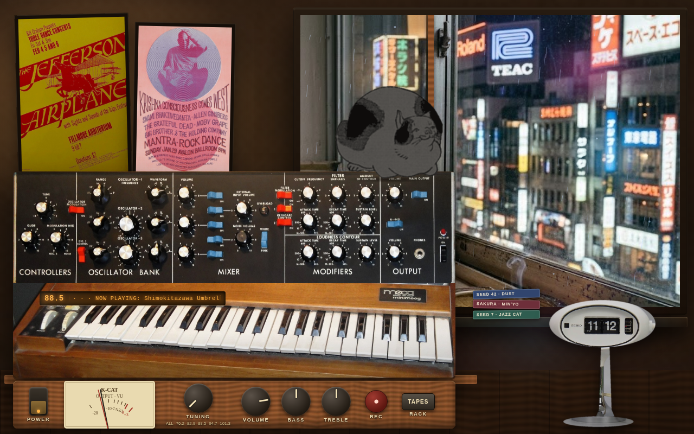

# blackcat9 — K-CAT 99.9 📻🐈‍⬛

### ブラックキャット9 — 雨の東京のアパートから放送中
*"Broadcasting from a rainy Tokyo apartment."*

       

**▶ Listen live: [wifiknight45.github.io/blackcat9](https://wifiknight45.github.io/blackcat9/)**

A procedural lofi radio station broadcasting from a rainy Tokyo apartment
in 1974. Every song is **synthesized from scratch** — no samples, no
recordings — from a deterministic seed: the same seed always makes the
same song, on any machine, forever.

Five stations on the TUNING dial:

- **DUST 88.5** — boom-bap & tape (Dilla's swing, heavy crackle)
- **JAZZ CAT 94.7** — modal & melancholy (Nujabes changes, space to breathe)
- **SUNRISE 101.3** — warm & weightless (Tycho pads, clean air)
- **MIN'YŌ 76.2** — 民謡 folk songs: miyako-bushi melodies plucked
  koto-style, field rain, festival drums far away — with *Sakura Sakura*
  and *Furusato* in rotation, transcribed from published scores
- **KISSATEN 82.9** — 喫茶店 jazz: a smoky Tokyo jazz café at midnight,
  all swing and brushed gold

Turn it on and the first thing you hear is the signature track —
seed 42 on DUST, *"Shimokitazawa Umbrellas"* — chosen by ear, pinned
in the code (`SIGNATURE_SEED` in `kcat/recipes.py`).

The console is a 1970s Moog-hearted receiver: a ladder filter at its
core, wood cheeks, VU meters — and a black cat named **Nine** who sleeps
on top where it's warm. The web console (GitHub Pages) is the same
station in your browser: rain on the window, neon over Shinjuku, and a
REC deck that captures songs off the radio to WAV tapes.

## Status

**On air.** The full engine (S0–S4) and the web console (S5) are built
and pushed: recipes and theory core; EP, bass, synthesized drums,
vibraphone and Moog-ladder leads, pads, Karplus-Strong plucked strings,
vinyl crackle and tape wobble; the infinite radio with static and
station idents between tracks; a Web Audio twin of the whole engine
whose recipes are byte-identical to the Python originals (39/39 parity
tests); and the console itself — POWER with tube warm-up, a TUNING
dial, live VU meters, bass/treble on real filters, and the REC tape
rack. Next up: more stations on the dial.

## Run it

```bash
git clone https://github.com/wifiknight45/blackcat9.git
cd blackcat9

# print a song's recipe (its DNA) as JSON
python3 -m kcat recipe --seed 42 --channel dusty

# save one to a file
python3 -m kcat recipe --seed 7 --channel jazz-cat --out seven.json

# run the tests (pure stdlib, no install needed for S0)
python3 -m unittest discover -s tests -v

# hear the station: one continuous broadcast as a single WAV,
# with a JSON program guide beside it. The same session seed
# replays the same broadcast, forever. --tape-dir is the REC deck:
# every track also lands there as its own WAV.
python3 -m kcat radio --seed 9 --tracks 3 --tape-dir tapes

# the web console, locally (ES modules need http, not file://)
cd web && python3 -m http.server 8000
# then open http://localhost:8000 in a browser and press POWER
```

## Design in one paragraph

One musical brain, two renderers. A **recipe** — seed, channel, tempo,
key, progression, feel knobs — fully describes a song as JSON. The
Python engine renders it with numpy; the web engine (Web Audio) reads
the same recipe and plays the same song. Seeds are the catalog:
share a seed, share the song.

## The console



The GitHub Pages site *is* the console: a 1974 Tokyo apartment at
night, the receiver on the desk, rain working its way down the window
glass. **POWER** warms the tubes and starts a session — signature
track first, then the seeded wander of the dial. **TUNING** pins one
station or leaves the whole dial on; every change rides in on static
and a synthesized station ident. **REC** renders the track you're
hearing to a tape on the rack — and a tape is just a recipe, so it
re-renders identically every time you play it. The VU needles read
the live output; BASS and TREBLE are real filters in the chain.

**Nine** sleeps at the warm right end of the console, in front of the
window. She's a woodblock cat — cut from Utagawa Kuniyoshi's cat
prints (public domain) and re-inked black with her red collar — and
she is a still image, like the posters on the wall. Cats on receivers
mostly sleep; so does she.

## Adding a station

The dial builds itself from the station table. Add one entry to
`CHANNELS` in `kcat/recipes.py` — tempo range, modes, keys, swing,
dust, a lead voice, and a label carrying its frequency, like
`"DUST 88.5 — boom-bap & tape"` — mirror it in `web/js/recipes.js`,
extend the parity goldens, and the new station appears on the
console's TUNING knob automatically. Seeds need no registry at all:
every session draws fresh ones, forever.

## Art & photo credits

- Console face: Minimoog (Buffalo Museum of Science) via Wikimedia
  Commons — CC BY 2.0.
- Posters: Jefferson Airplane, Fillmore 1966 — public domain;
  Mantra-Rock Dance 1967, photo Harvey W. Cohen — CC BY-SA 3.0.
- Nine: after Utagawa Kuniyoshi's cat prints — public domain.
- Flip clock: auction listing photo, used as a design placeholder
  and slated for replacement with a licensed image.

## License

Apache-2.0. All music the engine generates is synthesized by the code —
there are no samples to license.
